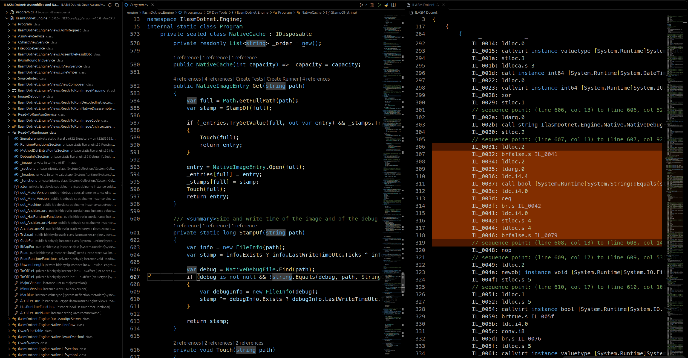
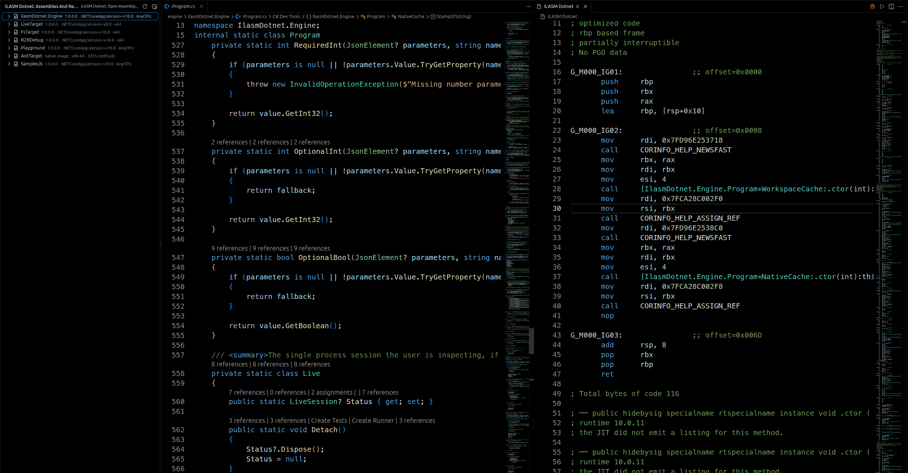
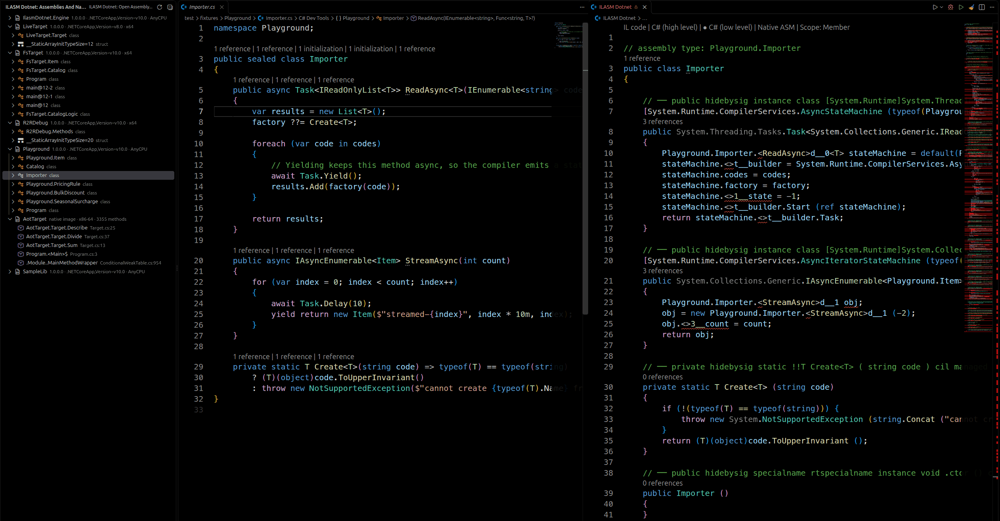

# 🔍 ILASM Dotnet for VS Code

**English** · [Русский](README.ru.md)


A viewer of IL/ASM and decompiled C# code for .NET assemblies.

The main mode is **one panel with two drop-down lists**: what to show (`IL code`,
`Decompiled C#`, `Native ASM`) and for what (`Entire file` or a specific member). The panel is opened
once and reused, so looking at a dozen methods does not leave a dozen tabs behind.

Besides it there are regular editor tabs with the same information — they offer the standard search,
folding and selection synchronization. A cursor in IL highlights the line of your source (by sequence
points from the portable PDB), a cursor in the source highlights the matching IL instructions (and the
panels of C# and ASM — the member that this line belongs to).

The ASM panel can read code in three ways: from a **ReadyToRun image** (the code lies in the file
itself — no process, no rebuild, and this is the only route that shows code of another architecture),
through **attach to your running process** (next to every instruction you can see which IL instruction
it implements, and the cursor leads to the exact source line) and through a harness that compiles the
method in a separate process. On top of that, the whole listing can be assembled back into an assembly
with `ilasm` — the assembler ships together with the extension.

**Requirements**

* **VS Code 1.105** or newer.
* **.NET 10 runtime** — the engine is launched via `dotnet` and ships as a
  platform-independent build. A newer runtime will do as well (`RollForward=LatestMajor`),
  an older one will not.
* Building from source additionally needs **Node.js 22.18** or newer and the **.NET 10 SDK** — see
  [Build and run](#-build-and-run). The scripts are TypeScript and Node runs them directly by
  stripping the types, which is what the version requirement is about.

**First steps.**

1. Open a project with a `.csproj` (or `.fsproj` / `.vbproj`) and put the cursor into a method.
2. `Ctrl+Alt+I` — a single viewer tab opens to the right of the source, the code stays visible on the left.
3. The view (IL / C# / C# low level / Native ASM) and the scope (file / member) are switched by the
   CodeLens row above the code or by `Ctrl+Alt+Shift+I`.

The mapping works right away: a cursor in the source highlights IL instructions, a cursor in IL
highlights the source line. If the mapping is missing, it is almost always the absence of a PDB: what
that means is described in [What you see when something is wrong](#-what-you-see-when-something-is-wrong),
and `ILASM Dotnet: Show Diagnostics` will gather the overall picture.

## 📑 Contents

- [📸 Screenshots](#-screenshots)
- [✅ What already works](#-what-already-works)
- [📦 What is read](#-what-is-read)
- [🧱 Architecture](#-architecture)
- [📁 Repository structure](#-repository-structure)
- [🌳 Side tree](#-side-tree)
- [🪟 Viewer: one native tab](#-viewer-one-native-tab)
- [📜 Commands](#-commands)
- [🧰 Settings](#-settings)
- [🔨 Build and run](#-build-and-run)
- [🧪 Tests](#-tests)
- [🔬 How the native ASM is produced](#-how-the-native-asm-is-produced)
- [🧳 Single-file publish](#-single-file-publish)
- [🚀 NativeAOT: ASM without IL](#-nativeaot-asm-without-il)
- [🎯 Exact mapping: attach to a live process](#-exact-mapping-attach-to-a-live-process)
- [🧩 F#, VB and any other .NET language](#-f-vb-and-any-other-net-language)
- [🧊 ASM straight from a ReadyToRun image](#-asm-straight-from-a-readytorun-image)
- [🔁 Assembling IL back: ilasm round-trip](#-assembling-il-back-ilasm-round-trip)
- [🚧 Limitations](#-limitations)
- [📮 Packaging](#-packaging)
- [🔭 What is left](#-what-is-left)
- [🔐 Privacy](#-privacy)
- [📄 License](#-license)

**Legend:** ✅ — works; ⚠️ — works with caveats, they are described in the table; ❌ — not supported.

## 📸 Screenshots

All three are the same viewer tab — only the view and the scope change. The source file stays on the left,
the listing on the right, and the cursor in the source highlights what it produced.

**`IL code`**



**`Native ASM`**



**`C# (low level)`**



## ✅ What already works

| Capability | State |
|---|---|
| A single **native viewer tab**: view switcher (IL / C# / ASM) and scope switcher (file / member) | ✅ done |
| IL, C# and ASM of **the whole file** at once (all types and bodies declared in the file) | ✅ done |
| IL listing of a type/method (complete, with `.class`/`.method`, locals, exception handlers) | ✅ done |
| Sequence point annotations right in the IL (`// sequence point: (line 18, col 13) ...`) | ✅ done |
| Decompilation to C# (ILSpy engine, `ICSharpCode.Decompiler`) | ✅ done |
| Two kinds of C#: **high level** (as the code is written) and **low level** (what the compiler made of it, together with generated types) | ✅ done |
| Exact **IL ↔ source line** mapping by PDB | ✅ done |
| Two-way highlighting **and scrolling** of IL ↔ source file as the cursor moves | ✅ done |
| Clickable links from sequence points into the source file (`#L18`) | ✅ done |
| **IL ↔ decompiled C#** mapping (by method/member) | ✅ done |
| Side tree: **the currently open file** → types → members, then the project assemblies | ✅ done |
| Assembly tree: assembly → types → members, with lazy loading | ✅ done |
| IL syntax highlighting (TextMate grammar) | ✅ done |
| Automatic lookup of the assembly for the open `.cs` file (by `.csproj` and `bin/**`) | ✅ done |
| Native ASM from the JIT (x64), optimized or tier 0, with syntax highlighting | ✅ done |
| IL ↔ C# ↔ ASM mapping by method as the cursor moves | ✅ done |
| **attach to a running process** (ClrMD): the code of exactly the JIT that is running right now | ✅ done |
| **ASM ↔ a specific IL instruction** — next to every instruction its `IL_xxxx` | ✅ done — both on a live process and from a ReadyToRun image |
| **ASM ↔ source line** and jumping from an instruction into the source | ✅ done — both on a live process and from a ReadyToRun image |
| Reading ASM **straight from a ReadyToRun image**: no process, no JIT, exactly the code that executes | ✅ done |
| **ARM64** code of an R2R image on an x64 machine (Capstone disassembler) — with the same mapping to IL | ✅ done |
| **Assembling the listing back** into an assembly with `ilasm`, verifying that nothing was lost | ✅ done |
| **F# and VB**: a project in any .NET language is an equal source; a `.fs`/`.vb` file opens the IL of its assembly | ✅ done |
| Properties and events are shown as properties, not as a nameless accessor block | ✅ done |
| Changing settings and rebuilding update an already open panel (the assembly on disk is re-read too) | ✅ done |
| A clear diagnosis for a native file (NativeAOT, ELF/Mach-O/native PE) instead of `Unknown file format.` | ✅ done |

## 📦 What is read

The tool works from metadata and debug information, so its limitations are not "by framework
version" but by file format.

| What | Support |
|---|---|
| IL and decompiled C# | ✅ any managed assembly that the metadata reader understands: .NET Framework 2.0+ (`mscorlib`), .NET Core / .NET 5–10, netstandard, Mono; x86/x64/arm64. Verified on a real `Newtonsoft.Json` `lib/net45` — 511 types, 2754 lines of IL for a type, 1116 lines of C# |
| C# syntax on the output | ✅ it is defined by the decompiler, not by the target framework: `SetLanguageVersion` is not called, so the default of `ICSharpCode.Decompiler` 11.1.0.9782 applies — `LanguageVersion.Latest` (feature flags of C# 14: `ExtensionMembers`, `FieldKeyword`, `UsePrimaryConstructorSyntaxForNonRecordTypes`, `ParamsCollections`, `RequiredMembers`, `Utf8StringLiterals`…). Records and file-scoped namespaces are restored even from old IL |
| ASM from the JIT | ⚠️ works if the runtime that runs the engine can load the assembly. This is **not** the runtime of your application: on your machine the engine runs on 10.0.11 (`RollForward=LatestMajor`), and the code comes from its JIT. Loading a net45 assembly worked as well (through facades), but exotic dependencies on Framework-specific APIs may fail to load |
| ASM from a ReadyToRun image | ✅ without running the code, x64 and arm64, linux/windows/osx; for an unsupported architecture (for example linux-arm) — an honest note instead of a silent fallback |
| ASM of a live process (ClrMD) | ⚠️ x64: the Iced decoder is hard-wired to 64 bits |
| Debug and Release | ✅ the same; a PDB is needed **only** for the file-wide views and for the source ↔ IL mapping. In Release (portable PDB by default since .NET 6) sequence points are rarer, so the nearest annotated line within 25 lines is taken. `DebugType=none` → by type/member everything is still readable, while the file views honestly print `; No debug information is available…`. A Windows "full" PDB is not read at all (only portable is supported) |
| NativeAOT | ❌ IL and C# — **no**: an AOT image has no IL, the bodies are already machine code, and this is a limitation of the nature of the image. **The machine code of a method — yes**: ELF, symbols with addresses and sizes plus DWARF (`.debug_info` for names, `.debug_line` for source lines) — see [NativeAOT: ASM without IL](#-nativeaot-asm-without-il). Linux and an unstripped image are required; by default publishing puts the debug information next to it in `Foo.dbg`, and the viewer finds it by `.gnu_debuglink` |
| `PublishTrimmed` (without AOT) | ✅ readable: the IL is in place |
| `PublishAot` from the editor | ✅ a project with `<PublishAot>true</PublishAot>` is read **from the image**, not from the intermediate `bin/**/<Name>.dll` it was built from: the code in them differs, and the second one is not what is executed. If there is no image next to it (it has not been published yet), the dll is taken |
| `PublishSingleFile` | ✅ readable: the file is a native host with the assembly and a manifest glued to the end, so the assembly inside is unpacked into a temporary directory and everything works as usual after that — IL, both kinds of C#, ASM from the JIT, mapping to lines by the PDB next to the exe. Native pieces (the runtime itself for self-contained) are not unpacked: the metadata does not need them |

Under the hood: `ReflectionDisassembler` and `CSharpDecompiler` from **ICSharpCode.Decompiler 11.1.0.9782**,
metadata — `System.Reflection.Metadata`, portable PDB — `PortablePdbInfoProvider` (ILSpy),
live process — **Microsoft.Diagnostics.Runtime 3.1.512801** + **Microsoft.Diagnostics.NETCore.Client
0.2.661903**, disassembling — **Iced 1.21.0** (x64) and **Gee.External.Capstone 2.3.0** (arm64),
assembling the listing back — `ilasm` 10.0.12 from `runtime.*.Microsoft.NETCore.ILAsm`.

## 🧱 Architecture
```text
VS Code (TypeScript)                       .NET engine (net10.0, JSON-RPC over stdio)
┌────────────────────────────┐             ┌──────────────────────────────────────────┐
│ extension.ts               │             │ Program.cs        — call dispatcher      │
│  ├ IlasmDotnetDocuments    │  view/il    │ Views/IlViewService    — ReflectionDis-  │
│  │   ilasm-dotnet scheme:  │◄───────────►│                           assembler      │
│  ├ SyncController          │  view/csharp│ Views/CSharpViewService — decompilation  │
│  ├ SourceLinkProvider      │  assembly/* │ Metadata/PortablePdbInfoProvider — PDB   │
│  ├ AssemblyTreeProvider    │  map/*      │ Metadata/AssemblyEntry  — PE, metadata   │
│  └ AssemblyLocator         │  live/*     │ Views/SourceIndex      — file+line→member│
│                            │             │ Live/LiveSession    — process snapshot   │
│                            │             │ Live/LiveAsmService  — ClrMD + Iced      │
│                            │             │ ReadyToRun/*        — code from the image│
└────────────────────────────┘             └──────────────────────────────────────────┘
```

The engine, at startup, serves one JSON call per panel:

| Panel | Call | Data source |
|---|---|---|
| IL | `view/il` | `ReflectionDisassembler` + sequence points |
| C# | `view/csharp` | ILSpy decompiler |
| ASM | `view/asm` | the JIT of the runtime through a child process |
| ASM of a live process | `view/asmLive` | ClrMD: address, size and JIT mapping from the process |
| ASM from a ReadyToRun image | `view/asm`, `view/fileAsm` (by default) | tables of the R2R image + Iced/Capstone |
| Navigation | `assembly/*`, `map/*` | metadata and portable PDB |
| Live process | `processes`, `live/attach`, `live/detach` | `Microsoft.Diagnostics.Runtime` |
| Assembling back | `assemble/roundTrip` | `ICSharpCode.Decompiler` + `ilasm` |

Why an engine and not pure TypeScript: JS has neither an IL disassembler, nor a C# decompiler,
nor portable PDB reading. All the heavy work is done on .NET, the extension is responsible for the UI.

### 🔗 How the views are linked

Every panel is served as a set of blocks (`MapBlock`), where the text is tied to two anchors:

* `methodToken` + `ilStart`/`ilEnd` — binding to the method body (links IL and C#);
* `sourceFile` + `sourceStartLine`/`sourceEndLine` — binding to the source (links both views with your code).

The IL panel serves one block per instruction (offset → IL line → source line from the PDB).
The C# panel is assembled per member, so every method/property has an exact line range
and a token by which its IL is found.

A cursor in the source file walks through **all** open panels: IL is highlighted precisely, because
every instruction has a source line from the PDB, while C# and ASM — at the level of the member, because
that is the most precise anchor these views have (the ASM of the harness has no source lines at all, so
such a panel will not be highlighted — that is expected). At the same time the panel is **scrolled** to
the highlighted place if it is not visible (a listing of the whole file is hundreds of lines, there is no
point in looking for the needed method in it by hand); scrolling only happens when the match is
off-screen, so reading around the highlighted code is not disturbed. The same works in the opposite
direction: a cursor on an instruction in IL/ASM scrolls the source to its line. It is disabled by the
`ilasmDotnet.syncScroll` setting. The mapping also triggers on a simple switch between tabs: a click on a
`.cs` file (or on a panel) is also movement through the code, even if the cursor did not move.

## 📁 Repository structure

```text
src/                        TypeScript extension
  extension.ts              activation, command registration, status bar
  assemblyLocator.ts        locating the output assembly by project file and bin/**
  engine/                   launching the engine and JSON-RPC over stdio (client.ts), protocol DTOs (protocol.ts)
  viewer/                   one viewer tab: documents (ilasm-dotnet scheme), opener, sync,
                            mapping and viewSession (pure rules, without the VS Code API), nativeViewer,
                            outputs, quickPick, sourceLinks
  tree/assemblyTree.ts      tree: current file → types → members, then the project assemblies
  util/log.ts               the "ILASM Dotnet" output channel
engine/IlasmDotnet.Engine/  the C# engine (net10.0); Program.cs — call dispatcher
  Views/                    building the views: IL, C#, ASM, file, round-trip through ilasm
  Live/                     attach: process snapshot and ASM of the live JIT (ClrMD + Iced)
  ReadyToRun/               code from a ReadyToRun image, including arm64
  Native/                   ELF/Mach-O, DWARF, native debug file
  Metadata/                 PE, metadata, portable PDB
  Bundle/                   parsing of a single-file bundle
  Jit/                      the DOTNET_JitDisasm + PrepareMethod harness
  Rpc/                      JSON-RPC server over stdio
  Model/                    protocol DTOs
scripts/                    tests and tools: smoke, extension.test, inhost, copy-ilasm, a VS Code stub
test/fixtures/              fixtures: SampleLib, LiveTarget, AotTarget, FsTarget, Playground, R2RDebug
syntaxes/                   TextMate grammars for il and il-asm
resources/                  the ilasm-dotnet.svg view icon
images/                     the screenshots shown in this README
```

What exactly each part checks is described in [Tests](#-tests).

## 🌳 Side tree

In the ILASM Dotnet panel the section **with the current file** comes first, below it — the assemblies of
the project:

```text
▾ Catalog.cs                        2 type(s) · 24 member(s)
  ▾ Playground.Catalog              class
      .ctor()
      Add()
      Describe()
      LowStock()
  ▾ Playground.Item                 class
      .ctor()
      Name
      Value
▾ Playground                       1.0.0 · .NETCoreApp,Version=v10.0 · AnyCPU
  ▾ Playground.Catalog              class
      …
```

* The section follows the active editor: you switch the file — the section is updated.
* **Only those types and members that are declared in this file** are shown (according to the portable
  PDB), not the whole public surface of the type. For example, `MoveNext` from a state machine will
  not appear here.
* Clicking a file name opens the viewer panel for the whole file, clicking a member — for the member.
* If the output assembly is not found or the file is absent from the debug information, the node says
  so, instead of silently disappearing.
* The section appears only when a source file on disk is active: the tabs of the viewer itself do not
  show it.

## 🪟 Viewer: one native tab

The viewer opens as a **regular VS Code editor tab** — a single document that is reused for any file,
view and member. No webviews and no scattering of tabs.

```text
┌─ ILASM Dotnet ──────────────────────────────────────────────────────────────┐
│ ● IL code · C# (high level) · C# (low level) · Native ASM · Scope: Entire file │  ← CodeLens row
├─────────────────────────────────────────────────────────────────────────────┤
│   1  .class public auto ansi sealed beforefieldinit SampleLib.Calculator    │
│   2      extends [System.Runtime]System.Object                              │
│  …                                                                          │
└─────────────────────────────────────────────────────────────────────────────┘
```

### 🔀 Two kinds of C#

Decompiled C# comes in two kinds, and they are switched by the same row:

| View | What it shows |
|---|---|
| `C# (high level)` | the code as a human would have written it: `foreach`, `using`, `switch`, `await`, lambdas, string interpolation, auto-properties |
| `C# (low level)` | what the compiler made of it: loops over `GetEnumerator`, `try/finally` instead of `using`, comparisons instead of `switch`, a state machine instead of `await`/`yield`, anonymous methods instead of lambdas, separate declarations of local variables and no elimination of dead code |

The low-level view **always shows compiler-generated members** — nested state classes
(`<Evens>d__5`), display classes of lambdas, fields with names like `<>1__state` — regardless of the
`ilasmDotnet.includeCompilerGenerated` setting, which only controls the high-level view. The member list in
the scope switcher also follows the view: in the low-level one it contains generated members as well,
otherwise the state machine that is visible on the screen could not be selected.

Why this is needed:

* to compare syntactic sugar with what it produces: for example, `yield return` in the high-level
  kind and a state class with `MoveNext` in the low-level one;
* to see what a tool working at build time (Fody, PostSharp, source generators) added to the assembly:
  the high-level kind shows what is not in your file.

**The switching rule.** An entry command named after a file (`Open Viewer for This File`, a click on a
file in the tree) opens **the whole file** — it must not silently open a single member. A tree node
named after a member, on the contrary, narrows the tab down to that member, as does the scope switcher,
whose choice is preserved when the view changes.

**A type has no single body.** The ASM panel shows code by methods, so for a **type** it takes the
bodies of all its methods (together with nested types — that is how the state machine of an iterator gets
into the listing), and for a member — its body. A type without bodies (a marker interface, an empty
class) answers with the line "there is no method body", not with an error. And if a view cannot be read
for some reason, the tab says so directly: earlier a failed read left the previous text on the screen,
and that looked like a switcher that did nothing.

**Clicking a tree node gives the same workbench as entering from the file itself.** A node is a metadata
token: by the PDB (RPC `map/fileOf`) it is resolved into the **source file and the first line** of that
type or member. Therefore a click opens the `.cs` on the left, puts the caret on that member
(`map/fileOf` returns the line) and next to it, in the right column, shows the viewer tab, **immediately
in the C# view** — an assembly explorer where code is read, while IL and ASM are switched with one click
in the same tab. After that the mapping works as usual: a cursor in the source highlights and scrolls the
tab, a cursor on an instruction leads to the source line. The token is resolved through **nested** types
as well, so a type whose whole body the compiler moved into a generated type (an async one or an
iterator) is found too, and the ASM icon next to a member opens the native code of that same member. If
the assembly has no PDB, there is no file, but the member still opens: the tab shows it alone, and
"Entire file" is not offered in the scope switcher — a choice that could only fail to work is not needed
in the list.

**The context menu of a `.cs` file has one command** — `ILASM Dotnet: Open Viewer for This File`. Since
inside the tab there is a switcher of the view (IL / C# / C# low level / ASM) and of the scope, a
separate button for each view would only duplicate it. The other entry commands have not gone anywhere:
they are available from the command palette (`Ctrl+Shift+P`) and from the context menu of tree nodes.
Commands that open views **in separate tabs** (for example, to put IL and C# side by side) are named
exactly that — `Open IL and C# in Separate Tabs ...`.

**Where it opens.** The viewer tab is placed **to the right of the source**, not on top of it: the code
stays visible on the left, IL/ASM is read next to it. When it is opened again the tab stays in its own
column, switching the view and the scope does not move it. If there are no open editors at all, the tab
takes the only column: there is nothing to be "next to", and a split would leave an empty column with an
invitation to open a file on the screen.

### 🔧 Properties and their accessors

As a scope one can select not only a method but also a property accessor — `get_Count`. In C# a separate
accessor does not exist: the panel shows **the whole property** (`public int Count => _history.Count;`)
and says which member the requested accessor belongs to. In the scope list such a member is labelled by
the property — `Count (get)`, — and not as `get_Count()`. The IL panel remains a method in that case:
the accessor exists in the metadata, and its IL is its IL. The blocks of the C# panel keep the token of
the accessor, so the mapping between the panels is not lost. In the type view the property is printed
once: the accessor is no longer emitted next to it as a nameless block.

**One tab.** Switching the view changes the language of the document (`il` → `csharp` → `il-asm`), which
makes VS Code recreate the document, and the extension reports that the content is stale. Switching the
scope re-reads the content in place. In either case there is one tab.

### 🔒 About read-only

The document is served through a `FileSystemProvider` with `isReadonly` and `FilePermission.Readonly` in
`stat`. VS Code in this version does **not** forbid edits in the buffer for such a document (verified in
a live host: `editor.edit()` returns `true`). Therefore the extension additionally watches for changes
and re-reads the content right away — a random character does not stay in the viewer. Nothing is saved
to disk, so real files cannot be damaged.

### 🚨 What you see when something is wrong

The engine sends **notes** to a view (`notes`): a method has no code left, the image has no code for
these methods, the PDB was not found, the architecture of the image is not supported. Earlier they were
read only by the old multi-panel mode. Now they are visible in the tab itself: a $(warning) icon appears
in the status bar (with the full text in the tooltip), and if there is nothing to show at all, the reason
is written right into the listing.

A separate case is a file all of whose bodies the compiler moved into
generated types: this is what any file with an `async` method or an iterator looks like, because the body
of such a method lives in a generated state machine, and the PDB breakpoints are attributed to it. With
the default settings there are no visible members in such a file, and earlier the tab was **empty** — the
user saw emptiness and did not know what to look at. Now **the type that declares this code** is shown:
for `Program.cs` with `async Task<int> Main()` it is `public class Program` with the `async` method
restored from the state machine, and above it there is a `;` header explaining why the code looks exactly
like that. `"ilasmDotnet.includeCompilerGenerated": true` adds generated members (`<Main>d__0`, `MoveNext`)
and to the file scope as well, while the `C# (low level)` view shows the state machine the way the
compiler emitted it.

**The PDB is checked against the assembly.** Next to a `.dll` there may lie a PDB from another
assembly — an incomplete build, a copied file. Earlier its breakpoints were read as its own, and the
request failed with `Read out of bounds.`; now the PDB identifier is compared with the CodeView record of
the assembly, and a foreign PDB is simply ignored: the view opens, but without source lines.

**A native image is not a broken assembly.** If you point at a file that is not a managed assembly
(a NativeAOT binary, an ordinary native library, just a text file), earlier everything ended with
`Unknown file format.` — the same for all causes. Now the file header is recognized before the metadata
is read: `hello is a native ELF image for x86-64, not a managed assembly. A native image holds
machine code and no IL, so there is nothing for an IL or C# view to read here. A binary published with
NativeAOT looks like this: its method bodies exist only as native code.` ELF (Linux, with the machine
named), Mach-O (macOS), a native PE without metadata (Windows) and "neither PE nor ELF" are told apart;
a file that is too short is also called by its own name. The cause is not lost: it is visible in the
tree — the path stays in the list with a `warning` mark and this text, — and in the tab
(`; ILASM Dotnet could not read this view.`), and in the notification when the file is opened with the
Open Assembly command. More about what can be read is in [What is read](#-what-is-read).

### 🩺 Diagnostics

`ILASM Dotnet: Show Diagnostics` gathers into one document everything needed to investigate a problem: the
extension version, the VS Code version, the platform and architecture, the path to `dotnet`, the path to
the engine, the settings (`asmSource`, `asmOptimized`, `includeCompilerGenerated`, `syncScroll`,
`ilasmPath`), whether attach is active, what exactly the tab is showing and whether a suitable portable
PDB was found for the assembly.

### 🔄 Why the content is refreshed after all

VS Code decides whether to re-read a file by `mtime` and the size from `stat`. If they do not change, a
declared change looks like the absence of a change and the document keeps the old text — this was a real
bug found by a test in the live host. Now the provider keeps a version counter and returns it as `mtime`.

The panel refreshes itself when its content stops being correct:

* **a settings change** (`ilasmDotnet.includeCompilerGenerated`, `asmSource`, `asmOptimized`, `ilasmPath`) —
  the extension listens to `onDidChangeConfiguration`, resets the view caches and re-reads the open panel
  together with the scope member list. The cache distinguishes the C# views by the setting and ASM by the
  source and the optimization mode, otherwise the panel would stay in its previous state;
* **saving a `.cs`** — the thing after which a build usually starts: the caches are reset, the tree and
  the panel are re-read;
* **rebuilding the assembly** — the engine keeps open assemblies in an LRU cache, and earlier after a
  build the project kept showing the old IL. Now a cache entry has a fingerprint of the file (size and
  write time): as soon as the file on disk changes, the assembly is opened anew. This is verified by an
  end-to-end test — the assembly file is replaced with another assembly, and the view must show the one
  that lies on disk.

## 📜 Commands

| Command | What it does |
|---|---|
| `ILASM Dotnet: Open Viewer for This File` | **the main command** and the only one in the `.cs` context menu: opens the single tab with the IL of the file |
| `ILASM Dotnet: Open in Viewer` | where a click on a type or member in the tree arrives: the same tab, immediately with the code of that type or member |
| `ILASM Dotnet: Open Viewer with ASM for This File` | the same, but immediately with the ASM view; for a type the listing gets the bodies of all its methods, for a member — its body |
| `ILASM Dotnet: Select View` / `Select Scope` | switchers (they are invoked by the CodeLens row and the status bar) |
| `ILASM Dotnet: Open IL and C# in Separate Tabs (This File / Current Line)` | opens the type or method under the cursor in **regular editor tabs** — next to each other, with the standard search and folding |
| `ILASM Dotnet: Open Assembly...` | pick a `.dll`/`.exe` manually and choose a type |
| `ILASM Dotnet: Go to Source Line` | from an IL **or ASM** instruction jump into the source |
| `ILASM Dotnet: Open Native ASM in a Separate Tab` | open the native code panel for the current method |
| `ILASM Dotnet: Attach to a Running Process...` | choose a running process and read the code of its JIT |
| `ILASM Dotnet: Detach from the Process` | go back to disassembly from the image or through the harness |
| `ILASM Dotnet: Assemble the IL Back with ilasm` | assemble the listing back into an assembly and verify the result |
| `ILASM Dotnet: Copy IL to Clipboard` | copy the IL |
| `ILASM Dotnet: Copy C# to Clipboard` | copy the decompiled C# of what the tab is showing |
| `ILASM Dotnet: Show Diagnostics` | a report about the environment and about what is open: versions, paths, settings, PDB, attach |
| `ILASM Dotnet: Refresh Assemblies` | rescan the assemblies and reset the cache |

The context menu in the C#, F# and VB editor contains `ILASM Dotnet: Open Viewer for This File`.

### 🎹 Keyboard shortcuts

| Keys | What it does | Where it works |
|---|---|---|
| `Ctrl+Alt+I` | open the viewer for the current file | in the C#, F# or VB editor |
| `Ctrl+Alt+Shift+I` | switch the view or the scope | in the viewer tab |
| `Ctrl+Alt+O` | go to the source line | in the viewer tab |

## 🧰 Settings

| Setting | Default | Meaning |
|---|---|---|
| `ilasmDotnet.dotnetPath` | `dotnet` | the host for launching the engine |
| `ilasmDotnet.enginePath` | empty | the path to `IlasmDotnet.Engine.dll` or to the published binary |
| `ilasmDotnet.includeCompilerGenerated` | `false` | whether to show state machines and lambdas in the C# panel |
| `ilasmDotnet.syncOriginalSource` | `true` | whether to highlight source lines as the cursor moves in IL |
| `ilasmDotnet.syncScroll` | `true` | whether to scroll the linked panel (or the source) to the highlighted place if it is not visible |
| `ilasmDotnet.asmOptimized` | `true` | whether to ask the JIT for optimized code (`FullOpts`) instead of tier 0 |
| `ilasmDotnet.asmSource` | `auto` | where to take ASM from: `auto` (attach → image → JIT), `image` (image only), `jit` (harness only) |
| `ilasmDotnet.nativeIncludeRuntime` | `false` | whether to show runtime methods next to application methods in a native image |
| `ilasmDotnet.ilasmPath` | empty | the path to `ilasm`; by default the one shipped with the extension is taken |
| `ilasmDotnet.maxAssembliesPerProject` | `1` | how many output assemblies to look for per project |
| `ilasmDotnet.assemblies` | empty | assemblies and native images to show in the tree in addition to those found in the workspace; it is also a way to open a file that has no project |

## 🔨 Build and run

```bash
npm install                 # extension dev dependencies
npm run build:engine       # dotnet publish to out/engine
npm run compile             # tsc --noEmit + esbuild
```

Then F5 (`Run ILASM Dotnet`) — the Extension Development Host will open. To try it, open
a project with a `.csproj`, put the cursor into a method and invoke
`ILASM Dotnet: Open Viewer for This File`.

A build without a PDB works too: IL and decompiled C# will be shown, but the mapping to the source
will be unavailable — the extension will honestly report that.

## 🧪 Tests

```bash
npm test              # 555 checks without a GUI: manifest, mapping, switching, integration, engine
npm run test:inhost   # 85 checks in a live VS Code extension host (will open a window)
npm run typecheck     # type check of the sources and of the dev scripts
npm run check         # compile + typecheck + build:engine + test
npm run package       # build dist/ilasm-dotnet-<version>.vsix
```

The dev scripts are TypeScript, and Node runs them directly by stripping types, so a rebuild step is
not needed to run a test. The one exception is the in-host test: its source is
`scripts/inhost/index.ts` and `npm run test:inhost` compiles it to `out/inhost/index.js` first, because
VS Code loads that file with its own CommonJS loader.

* `scripts/manifest.test.mts` — validity of the manifest, menus, grammars, paths, keyboard shortcuts
  (each one refers to a declared command and is not duplicated in the same context).
* `scripts/mapping.test.mts` — unit tests of the pure mapping functions (line boundaries, path normalization, tokens).
* `scripts/viewsession.test.mts` — the switching rules: which engine call corresponds to
  a state, how the view and the scope are labelled, what the CodeLens row contains. The module
  `src/viewer/viewSession.ts` deliberately does not depend on VS Code.
* `scripts/extension.test.mts` — loads the built extension on a VS Code API stub, starts
  a real engine and checks the commands, documents, switching of the view and the scope, highlighting,
  links, the tree (including the node with the reason why a file cannot be read, and the native image
  node with its methods), the current file section, the **live process** (`test/fixtures/LiveTarget` is
  started and attached to), reading ASM from a ReadyToRun image, both views of C#, changing the settings
  and re-reading an open panel, property accessors, highlighting and **scrolling** of the linked panels
  (including switching between tabs and the `ilasmDotnet.syncScroll` setting), a click on a tree node (it
  must land in the single tab with the switcher), a round-trip through `ilasm` and both ASM source
  settings.
* `scripts/smoke.mts` — an end-to-end check of the engine on the `test/fixtures/SampleLib` fixture
  (it is built automatically), of the live mapping (`IL_xxxx` of every instruction is compared with the
  IL listing of the same method), of reading code from the R2R images for linux-x64 and linux-arm64 (the
  sizes from the image are compared with the sizes from the live process, and the arm64 listing is
  checked for the absence of x64 instructions), of an assembly that has already been read and then
  replaced with another one (the cache must notice the change), of an image of a foreign architecture
  (the listing must say whose code this is), of native images (ELF/Mach-O/PE without metadata from
  `out/engine/ilasm` — the diagnosis must name the format and say that there is no IL in the file,
  while a managed assembly must still be readable) and of the round-trip: a listing with
  `try/catch/filter/finally` must be assembled by the same `ilasm`; `map/fileOf` is checked on a type,
  on a member (including the line the caret will land on), on a type whose bodies live in a nested
  generated type, on an unknown token and on an assembly without a PDB. The `test/fixtures/AotTarget`
  fixture is published as NativeAOT and checks the native route: addresses and sizes of methods, names
  from DWARF, source lines of instructions, block boundaries and that a stripped image honestly reports
  the missing debug file. The same `LiveTarget`, published as a single file, checks bundle parsing:
  the assembly from it is read, IL/C#/ASM and the mapping to lines work, and a file with a truncated
  manifest is rejected. The `test/fixtures/Playground` fixture adds what the library does not have: an
  entry point `async Task<int> Main` whose body the compiler moved into a nested generated type, — a file
  consisting entirely of such bodies must show the code of the type that spawned them, not emptiness,
  and a PDB of a foreign assembly placed next to it must be ignored. The `test/fixtures/R2RDebug` fixture
  (net10.0) carries a second encoding of the "instruction → IL instruction" map: its ReadyToRun image
  packs the map into bit fields, whereas the `LiveTarget` image (net8.0) writes it as consecutive
  numbers — both forms must be readable.
* `scripts/inhost/index.ts` + `scripts/test-inhost.mts` — what the stub cannot check:
  a real VS Code is launched in an isolated profile, the language of virtual
  documents is determined, document links are resolved, panels open side by side, the ASM panel gets
  code from a real JIT, a setting change must re-read the open panel, a cursor in the source must
  **scroll** the panel to the needed method (and vice versa), a click on a tree node with the editors
  closed must open a single tab with the code of that node, the source on the left with the caret on the
  member and **not** leave an empty column, the ASM icon of a node must show the native code, and attach
  to a process is checked at the end by a jump from an instruction to the exact source line. The script
  can also check an **installed VSIX**: `node scripts/test-inhost.mts --vsix dist/ilasm-dotnet-1.0.1.vsix`.

## 🔬 How the native ASM is produced

The ASM panel does not emulate a disassembler: it asks for the code from the same JIT that executes it.
The engine launches **its own** dll as a harness with the `DOTNET_JitDisasm` variable, but instead of
invoking the method it asks the runtime to compile it:

```csharp
RuntimeHelpers.PrepareMethod(method.MethodHandle);
```

Therefore the ASM appears **without executing the method body** — this is verified by a test on a fixture
where the method writes a file: the file is not created. A side effect worth knowing about: loading the
assembly executes its module initializer, like any load through reflection.

What this gives:

* real runtime code, not a reconstruction — including folded expressions and inlined code;
* `FullOpts` with `DOTNET_TieredCompilation=0` (the `ilasmDotnet.asmOptimized` setting, enabled by default), a byte counter and inlining statistics;
* tier 0 if the setting is turned off;
* the header shows the runtime and the kind of code: `; FullOpts, 77 bytes of code, runtime 10.0.11`.

What this route does not give, and this is honestly stated in the panel itself:

* **the ASM → source line mapping**: `DOTNET_JitDisasmWithSource` adds nothing in .NET 10 (verified), so without attach the panel is linked to IL and C# **by method**. As the instruction says, the mapping is provided by the live route, see the next section;
* **optimization of debug builds**: the `[Debuggable]` attribute forbids optimization, so for a Debug build you will get `MinOpts` — the panel says so directly instead of staying silent;
* **generic methods**: they are compiled with `object` substituted as the representative, so the code is approximate;
* **methods the runtime has not compiled yet**: `PrepareMethod` does not compile everything, so the panel reports how many methods were left without native code.

## 🧳 Single-file publish

`dotnet publish -p:PublishSingleFile=true` produces one executable file: a native host to which the
assemblies of the application are glued, plus a manifest at the end of the file telling where what lies.
There is nothing of the application in the host itself, so for the metadata reader this is "not a .NET
assembly", and for the native route it is a stripped image without methods. Hence the parsing:

| Step | How it is done |
|---|---|
| Find the manifest | There is no marker in the file: the host knows the header offset "by heart". Therefore a position is searched where the manifest entries parse and end exactly at the end of the file; an entry says where its bytes are and how many there are, so reading past the end is almost impossible (`Bundle/SingleFileApplication.cs`) |
| Verify | All entry data lies before the manifest, the first assembly starts with `MZ` (for a compressed bundle — after unpacking its beginning), and the header before the manifest agrees on the number of files and the format version |
| Decompress | `EnableCompressionInSingleFile` (works only together with `--self-contained`) stores the bundle files as deflate streams, so the entry size in the manifest is the size of the file, not of the bytes it occupies; reading decompresses the entry, and the boundaries are checked against the occupied bytes |
| Unpack | Assemblies, symbols and both json files are expanded into `%TEMP%/ilasm-dotnet-bundle/<hash>`; the directory is derived from the path and the date of the file, so a rebuild is read anew. Native binaries are skipped: it is they that make a self-contained bundle big, and the metadata does not need them |
| Read | After that everything existing works: `AssemblyEntry` opens the extracted assembly, the PDB is looked up next to exe (`Foo.pdb`), references are resolved from the unpack directory, the JIT harness loads the already extracted assembly |

What you see: an ordinary assembly node in the tree, ordinary IL/C#/ASM, mapping to source lines — plus
in the status bar tooltip the line "The assembly was taken out of the single file application Foo". The
assembly locator for an open `.cs` now also looks for `bin/**/<Name>` (without an extension), not only
`<Name>.dll`, so such a project is found from the editor as usual.

It is verified by the `LiveTarget` fixture, which smoke and the extension test publish as a single file,
plus a negative check: the same file with a truncated manifest must be rejected, not read at random. A
second fixture publishes a **compressed self-contained** bundle (36 MB, 171 files): it checks both the
decompression of entries and that the manifest is located not at the beginning of the tail, but at its
own place in a large file.

Choosing the output of a project is a separate small task, because after a build `bin` contains several
files at once: the assembly, the native image built from it, and the host that launches it. They cannot
be told apart by names (in an AOT project the dll is **intermediate** IL, not what is executed; in an
ordinary project the host is a dummy without code), so the candidates (assemblies first, then
executables) are iterated by readability: the first one that turned out to be an assembly or an image
with methods is taken. The rule about `PublishAot` keeps the intention with the project: if it is marked
as AOT, its image comes first in the candidate list.

## 🚀 NativeAOT: ASM without IL

An AOT image has no IL at all — the method bodies are already machine code, so neither IL nor the two
views of C# are possible for it (this is a limitation of the nature of the image, not of the
implementation). What is possible is a third route: reading the native image itself.

What it does:

| Step | What reads it |
|---|---|
| Container | ELF: header, section table, symbols, compressed (zlib) debug sections — `Native/ElfImage.cs` |
| Debug information | by default an AOT publish leaves only a `.gnu_debuglink` reference to the `Foo.dbg` file in the image; it is looked up next to it and verified by CRC, like the PDB of a managed assembly — `NativeDebugFile.cs` |
| Methods | `Foo_Namespace_Type__Method` symbols with an address and a size, plus human-readable names from DWARF `.debug_info` — `DwarfNames.cs` |
| Source lines | DWARF `.debug_line` (a program that has to be executed to get the lines): address ↔ file and line — `DwarfLineTable.cs` |
| Disassembly | the same decoders as in the other routes: Iced for x64, Capstone for arm64 |

What you see in the end:

* the **tree** shows the native image as a separate node ("native image · x86-64 · N methods") with a list
  of methods: name, file and line, address and size in the tooltip;
* the **tab** shows the machine code of the selected method: `; ── AotTarget.Target.Sum (36 bytes at 0x6c240)`
  and instructions with addresses, and the **mapping to source lines works in both directions** — a cursor in `Target.cs`
  highlights and scrolls the needed part of the listing, a cursor on an instruction highlights the line
  (in the status bar there is an address instead of `IL_xxxx`);
* the **view switcher** in such a tab offers only `Native ASM`: there is no IL and C# there, and an attempt
  to switch answers with a reason, not with an empty panel;
* runtime methods of the runtime the image was built from (there are thousands of them) are hidden by
  default; `ilasmDotnet.nativeIncludeRuntime` shows them as well. If the name of the image matched no symbol
  at all, the list is shown in full, so that the image does not look empty.

How to open it: **Open Assembly…** (the dialog now has `All files` — an AOT binary usually has no
extension) or add the path to `ilasmDotnet.assemblies`. Opening from a `.cs` file still requires a managed
assembly in `bin`, so the tree is more convenient for AOT.

It is verified by the `test/fixtures/AotTarget` fixture: smoke publishes it as NativeAOT and checks
addresses, sizes, names, lines and block boundaries; the extension test checks that the tree node lists
methods, that a click on a method opens its code and that switching to IL is rejected with an explanation.

Limitations of this route:

* **Linux** (ELF). macOS — the same DWARF but in a Mach-O container, while Windows stores debug
  information in a native PDB (MSF format), not in DWARF: these are separate readers, they do not exist yet;
* **symbols** are needed: a fully stripped image (such images exist — for example the apphost of `ilasm`,
  which lies in the package) has an empty method list, and the viewer honestly says which file is missing;
* `.debug_info` units of DWARF version 5 (in images this is the code of the runtime itself) are not read —
  methods from them get a name from the symbol mangling, which the viewer reports in a note; `.debug_line`
  is read for both version 4 and version 5;
* methods that the compiler inlined are absent from the list — their code is not in the image.

## 🎯 Exact mapping: attach to a live process

The route through the harness gives the code of a similar method in a separate process. With attach, **the
very code that your process is executing right now** is read, together with the "native address →
IL instruction" map built by the JIT. Hence the precision: every instruction in the panel gets its
`IL_xxxx`, and a cursor on an instruction highlights (and lets you jump to) the source line that it
implements.

What happens under the hood:

| Step | Detail |
|---|---|
| Processes | `processes` enumerates the running .NET processes (`Microsoft.Diagnostics.NETCore.Client`) |
| Snapshot | by default a `WithHeap` dump is taken (~68 MB for a trivial application) — that is enough to read JIT code |
| DAC | ClrMD 4.x looks for the DAC through the symbol locator and on Linux does not download it, so the DAC of the target runtime itself is taken — the one lying next to the `libcoreclr` it loaded (the path from `ModuleInfo` or from `/proc/<pid>/maps`). The dump reports the runtime as `0.0`, and only for this case is a DAC version mismatch allowed: a DAC from another runtime remains an error |
| Attach | `live/attach` opens the dump in ClrMD: runtime, modules, `ClrMethod.NativeCode`, `HotColdInfo` |
| Disassembly | the bytes are read from memory through `IMemoryReader` and decoded by `Iced` (x64) |
| Map | `ClrMethod.GetILOffset(address)` → `IL_xxxx`; the prologue and epilogue are marked separately |
| Source | the IL offset is turned into a line through the PDB of the same assembly |
| Cache | one session per process: the bytes and blocks are reused when the view is switched |

Why a snapshot and not a direct attach: `ptrace` on Linux is restricted by default
(`kernel.yama.ptrace_scope = 1`) — only your own descendants can be debugged, and the extension is not
the parent of your process. The dump, on the other hand, is written by the runtime itself over the
diagnostic socket, so it works without `ptrace` and does not stop your program. The dump file is deleted
on detach and when the engine exits. ClrMD reports the runtime version in the dump as `0.0`, so it is
taken from `/proc/<pid>/maps`.

Limitations of the live route:

* the platform on which the runtime runs is what works: currently **x64** is disassembled;
* a method gets into the panel with an exact map only if it has already been compiled: if the method is
  not in the list, the panel says so ("the method has not been compiled yet; call it first"). A
  ReadyToRun method may have no code of its own at all — then it was inlined into the caller;
* attach needs the PDB of the assembly: without it there will be code and `IL_xxxx`, but not source lines.

## 🧩 F#, VB and any other .NET language

The viewer reads an **assembly**, not a language: C#, F#, VB and anything else compile into the same
metadata, so the source of code is simply the file from which the assembly of the project is found.
Hence everything a language gives:

| What | How |
|---|---|
| Assembly lookup | By the nearest project file upwards from the file — `*.csproj`, `*.fsproj`, `*.vbproj` |
| Context menu button | The condition `editorLangId == csharp \|\| ... == fsharp \|\| ... == vb`: the menu also appears in a `.fs` file |
| Keyboard shortcut | The same triple of languages, `Ctrl+Alt+I` |
| Mapping to the source | The lines are taken from the PDB, so the jumps lead into `.fs`/`.vb` — just like into `.cs` |
| The C# panel for an F# assembly | It is the C# **of the IL** that the F# compiler produced: the viewer has one decompiler, and it reads metadata. The same holds for VB |
| Rebuild after saving | Saving `.cs`, `.fs` or `.vb` resets the cache and re-reads the assembly |

Verified by the `test/fixtures/FsTarget` fixture (F#): IL and C# per file, mapping to a `.fs` line,
the JIT listing, and for a ReadyToRun image — the same "instruction → IL instruction" map, compared with
the runtime instruction by instruction.

## 🧊 ASM straight from a ReadyToRun image

If an assembly is published as ReadyToRun, its code lies in the file itself. The ASM panel reads it
**without a process and without a rebuild**: it is exactly the code that the application executes, and —
most importantly — this is how the code of **another architecture** can be looked at: an arm64 image is
read on an x64 machine, which is unavailable to the attach route in principle.

How the code of a method is found (the R2R format is described in `readytytorun-format.md` from dotnet/runtime):

| Step | Detail |
|---|---|
| Header | a PE has a native header directory: the `RRR` signature, the format version and a table of sections (type, RVA, size) |
| `RuntimeFunctions` (102) | a sorted list of code blocks: start, end (on x64) and a pointer to the unwind data |
| `MethodDefEntryPoints` (103) | a sparse array (native format) from a MethodDef row to the index of a block; the value = the index plus flags, and the number of flag bits depends on the lowest bit (no fixup — one bit, with a fixup — two) |
| `DebugInfo` (105) | the map "native instruction → IL instruction", the same sparse array keyed by block number, and after that the blob of the method |
| Size on arm64 | it is not in the table, it is taken from the unwind data: the first two bytes are the length of the function in 4-byte instructions |
| Disassembly | x64 — Iced (as in the live route), arm64 — Capstone, so the architectures of the image and of the machine may differ |
| Neighbouring blocks | a body may consist of several blocks (a funclet or a cold part): a block starting where the previous one ended belongs to the same method and is marked in the listing |

### 🧵 Mapping to IL from the image itself

In the format description the `DebugInfo` section is marked as TODO, but the encoding can be read from
the runtime sources, and now it is read: every instruction of a listing from an image has its `IL_xxxx`,
just like in the listing of a live process, and the panel links the listing line to the IL instruction
and to the source line through the PDB. Attach is no longer needed for this — and the same works for
arm64 code, which otherwise cannot be seen on an x64 machine.

| Step | Detail |
|---|---|
| Where the blob of a method lies | `DebugInfo` is a sparse array keyed by the block number in `RuntimeFunctions`; the value of an entry is either the offset of the blob or, when the entry is written as a full word, the distance back to the blob lying before it |
| Blob header | nibble numbers: the length of the part with the map and the length of the part with variables; a "fat" header (`0`) adds four more lengths, of which only the first is needed |
| Map, format ≥ 16 | the header of the part contains the number of entries and the widths of two of the three numbers of an entry, then the entries follow as bit fields; the kind of an entry is a fixed 2 bits |
| Map, format < 16 | the number of entries and then triples: the offset from the previous entry, `IL_offset + 3` and the kind of the entry — nibble numbers without alignment |
| Reference point | the offsets are native — from the start of the block, so several blocks of one body (a funclet, a cold part) are each read by its own map |
| Age of the target | verified on images of `net6.0`, `net7.0`, `net8.0`, `net9.0`, `net10.0`: the first three carry the old encoding in the section (formats 8.0/9.0/9.1), the last ones — the bit-field one (16.0), and both are read the same way. Separately verified that for a process on .NET 6 the listing from the image and the listing of the live process coincide instruction by instruction |
| Verification | the list from the image is compared with what the runtime returns for the same method through attach, instruction by instruction — the `.NET 8` and `.NET 10` fixtures check both encodings |

Along the way a couple of bugs in neighbouring code were found, and they are now covered by checks: the
block index in `MethodDefEntryPoints` was always read as `value >> 2`, because of which a method without
a fixup in the entry got the code of its neighbour (on `.NET 10` that is exactly what happened:
`Countdown` showed the body of `Grade`), and ClrMD marked an instruction starting exactly where the range
of the previous entry ends with the previous IL instruction — because of which the listing of the live
process and the listing from the image diverged by one instruction. Both places read the map as "the last
entry starting not later than the address" — the same way the runtime does it.

The architecture of an image is determined by the machine field: for
crossgen2 it has its own value for unix targets (the values are written out in the code with comments —
they were read from images built for each platform), and an image of an unknown architecture honestly remains
on the harness route.

About the last case the panel now says directly: if a file contains ReadyToRun code but it cannot be read
(the architecture is unsupported, the header is unreadable, there is no code for these methods in the
image), the first line of the listing names the cause — for example "`App.dll` carries ReadyToRun code for linux-arm, which
this build cannot disassemble (x64 and arm64 only)" — and says that the code below was compiled on this
machine and not taken from the file. With `ilasmDotnet.asmSource: image` the same text arrives as an error:
since the source was requested explicitly, a silent substitution would be a lie.

## 🔁 Assembling IL back: ilasm round-trip

`ILASM Dotnet: Assemble the IL Back with ilasm` takes the assembly open in the viewer, writes it out
entirely (the manifest, references, all types and bodies) into a single ILASM file, hands it to `ilasm`
and compares the result with the original: the number of types, the number of methods and their
signatures must match. This is the only check that does not take the viewer's word for it — a listing
that a real assembler accepts really is IL.

What is worth knowing:

* **The assembler ships with the extension** (~7 MB: linux-x64/arm64, osx-x64/arm64, win-x64).
  The `ilasm` from mono does not fit — it does not understand `.interfaceimpl`, which the disassembler
  writes. A custom path can be set with the `ilasmDotnet.ilasmPath` setting; if the given path does not
  exist, the shipped one is taken.
* **Exception handlers are rewritten.** The disassembler abbreviates them as
  `.try IL_000f-IL_002f finally IL_002f-IL_0039`, while the assembler expects
  `.try IL_000f to IL_002f finally handler IL_002f to IL_0039`. Both forms, as well as `catch <type>`,
  `fault` and `filter`, are verified on a real `ilasm`; the test on the fixture requires that a listing
  with `try/catch/filter/finally` is assembled.
* The generated `.il` is opened next to it so that it can be read and corrected; the path and the result
  are visible in the message. The files are put into the extension storage, not into the project.
* What the round-trip does not promise: byte-for-byte equality (tokens and layout change) and complete
  preservation of attributes — types and methods are compared. `ilasm` errors are shown as they are,
  with the listing line indicated.

## 🚧 Limitations

* The mapping of the **decompiled C# panel** to IL is at the level of the member (method/property), not
  of the line: the exact "AST node ↔ IL instruction" annotations in `ICSharpCode.Decompiler` are internal
  (`TranslatedStatement`, `ExpressionWithILInstruction`) and are erased when the text is rendered.
  The mapping of IL ↔ **your source** is precise in that case, by PDB.
* Compiler-generated members are hidden by default in the high-level C# panel, but visible in IL and in
  the low-level view — the highlighting of the high-level panel will not work for them (this is expected).
* The low-level view is a view of the decompiler, not of the disassembler: it shows the language
  constructs into which the compiler unfolds the sugar, but not individual IL instructions. Instructions
  are the IL view.
* Debug builds are decompiled with artifacts like `if (1 == 0) { }` — this is a property of
  unoptimized IL, not a bug of the viewer.
* The panels are read-only.

## 📮 Packaging

```bash
npm run package     # dist/ilasm-dotnet-1.0.1.vsix
code --install-extension dist/ilasm-dotnet-1.0.1.vsix --force
```

The package contains the extension bundle, the published engine, the grammars, the icon and two native
components: `ilasm` for five platforms and `libcapstone` for disassembling arm64. Capstone is shipped for
nine platforms, but only the five target ones are needed, so the rest are excluded in `.vscodeignore`
(otherwise the package grows by 20 MB). The sources, the tests and `node_modules` are excluded there as
well. The engine is published with `UseAppHost=false`, so there is no platform-dependent file in the
package, but an installed **.NET 10 runtime** is required. The engine is not tied hard to its target
framework: `RollForward=LatestMajor` lets it run on a newer runtime as well, if that one is installed
instead of the tenth.

The engine is also a JIT harness: it launches itself as a child process with the `DOTNET_JitDisasm` and
`RuntimeHelpers.PrepareMethod` variables, and the assembly under analysis is loaded by exactly the runtime
that executes the harness. Therefore the target framework of the engine (`net10.0`) is also the runtime
version whose code the "ASM from the JIT" route answers with.

The test fixtures run on .NET 10, except one: `test/fixtures/LiveTarget` stays on **net8.0**. That way two
things that cannot be obtained on the tenth runtime are checked at once: attach to a process of an older
runtime and the **old encoding of the map** "instruction → IL instruction" in an R2R image — the encoding
follows the target framework of the assembly, so an image for net8 carries format 9.1, and for net10 —
16.0, and the reader is checked on both.

## 🔭 What is left

* 🚧 **Other map encodings**: `.NET 8` and `.NET 9+` are read (9.1 and 16.0 are verified by fixtures),
  while older images (and "fat" blobs with additional parts) are not: for them the listing remains
  linked by method.
* 🚧 **NativeAOT for other platforms**: Linux is done. macOS — the same DWARF in a Mach-O container,
  Windows — debug information in a native PDB instead of DWARF; each of them needs its own reader.
* 🚧 **DWARF 5 units in `.debug_info`** (in AOT images this is the code of the runtime itself) are not read
  yet, their methods are named by the symbol mangling — see
  [NativeAOT: ASM without IL](#-nativeaot-asm-without-il).
* 🚧 **Other architectures**: Capstone can do arm32, x86 and riscv — currently none of them is supported,
  because their R2R tables are not supported.
* 🚧 **Small things**: caching the panels to disk, publishing to the Marketplace, verifying the actually
  installed extension (the in-host tests run on the unpacked package).
* 🚧 **Multi-targeted projects**: `<TargetFrameworks>net8.0;net10.0</TargetFrameworks>` — the freshest
  assembly from `bin/**` is taken, not the one selected in the IDE.

## 🔐 Privacy

The extension makes no network requests: no telemetry, no sending of assemblies, sources or dumps.
Neither the extension nor the engine has a single network call — the heavy part is computed locally, the
communication with the engine goes over stdio, and the child `dotnet` is explicitly given
`DOTNET_CLI_TELEMETRY_OPTOUT=1`, so that the telemetry of the CLI itself does not kick in
(`Views/AsmViewService.cs`).

Only what you opened is read: the assembly, its portable PDB, if necessary the `.dbg`/DWARF next to the
native image, and the process you connected to with the Attach command. To disk the extension writes only
its own artifacts: the `.il` generated for the round-trip in the extension storage and the unpacked
single-file bundle into a temporary directory.

## 📄 License

**MIT** — the full text is in [LICENSE](LICENSE). © 2026 Dmitry Sorokin (dimanrus).
